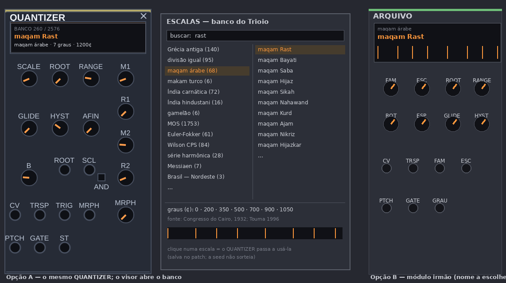

# Proposta — o banco de escalas do Trioio no Rasgo Modular

Data: 23/11/2026. Estado: **opção A implementada em 23/11/2026** (autor: "faça
sua recomendação") — §5. Pedido do autor (21/11): "concordo, mas depois
vamos implementar o banco completo se possível". Base: a interpolação de
escalas do QUANTIZER (dossiê 12, 21/11) e o recurso transversal
`KNOW-ESCALAS` (inventário global; o autor o declarou recurso de todos os
instrumentos RASGO em 9/10).

## 1. O banco

- `TRIOIO/data/escalas/arquivo_trioio.txt` (commit `7f09d60`, sha256
  `1d26d19e1ab30940…`): **2576 escalas** em 40 famílias, cada uma com
  família, período, graus em cents e **fonte citada**; 219 com razões, 32
  com comportamento (apoio, cadência, percurso…).
- Famílias maiores: MOS 1753, Grécia antiga 140, divisão igual 95, Wilson
  CPS 84, Índia carnática 72, maqam árabe 68, Euler-Fokker 61, conjuntos de
  classes de altura (5–9 notas) 167, séries harmônica e subarmônica 55.
- Escalas de 1 a 100 graus (a maioria de 5 a 7); 2571 com período de
  oitava, 5 não oitavantes (Bohlen-Pierce e outras).
- Licença: Trioio AGPL-3.0, conteúdo próprio (fontes citadas, nenhum
  arquivo de terceiros). Entra por **cópia fixada com proveniência**, como
  a família faz (§7.0): `third_party/trioio-escalas/` com commit, checksum e
  o gerador citado.

## 2. O que muda por dentro (técnico, igual nas duas opções)

- Hoje o QUANTIZER guarda graus em **semitons inteiros** (12 por oitava) e
  aplica as afinações (AFIN) por cima. O banco pede graus em **cents** (até
  100 por período) e período qualquer.
- Proposta: um caminho em cents ao lado do atual — as 12 escalas de hoje e o
  AFIN continuam idênticos (teste amostra a amostra, como no MRPH); a escala
  do banco só vale quando escolhida.
- O banco vai **dentro do app** (texto ~1,2 MB, lido uma vez no início),
  sem arquivo a instalar; o patch salva o **nome** da escala (não o índice),
  para continuar certo se o banco crescer.
- Fora da seed e do MUDA no começo (como o MRPH); um papel na seed pode vir
  depois, com escuta.

## 3. Duas opções de seletor (imagem acima)

**A — o mesmo QUANTIZER, com o visor abrindo o banco.** O knob SCALE ganha
uma última posição, BANCO; o visor mostra o nome, a família e o número de
graus. Clicar no visor abre um navegador: famílias à esquerda, escalas à
direita, busca por nome, os graus em cents e a fonte citada, e uma régua
com os graus. Nenhum knob novo no painel, que já está cheio.

**B — um módulo irmão só do banco** (nome a escolher). Knobs FAM e ESC para
andar pelo banco (também por CV), ROOT, RANGE, GLIDE, HYST, e as operações
da máquina de escalas do Trioio: ROT (rotação/modo) e ESP (espelho). O visor
mostra a régua dos graus. Tocável sem abrir janela; mais um módulo (#108).

**Recomendação: A**, com o navegador; ele também serve depois a outros
módulos que usam escala (HARMONY, KEY, ARP). Se o autor quiser andar pelo
banco com CV ao vivo, B (ou FAM/ESC em A, numa segunda etapa).

## 4. Decisões do autor

1. A ou B (ou A agora e B depois).
2. Se B: o nome do módulo.
3. Começar só com as escalas de período de oitava (2571) e deixar as 5 não
   oitavantes para depois — sugestão, por segurança do RANGE.

## 5. Implementado (23/11/2026)

- **Dados:** `third_party/trioio-escalas/arquivo_trioio.txt` (cópia fixada,
  `PROVENANCE.md`); `tools/gerar_banco_escalas.py` gera
  `src/escalas/BancoEscalasDados.inc` (~950 KB: nome, família, período,
  graus, fonte; 81 pedaços de string crua, dentro do limite dos
  compiladores). As 2576 escalas, as 5 não oitavantes também (o
  quantizador trabalha num período qualquer).
- **Leitor:** `src/escalas/BancoEscalas.hpp` (AGPL), lido uma vez no início
  do app, do plugin e da linha de comando, com o locale "C".
- **QUANTIZER:** SCALE vai a 13 (BANCO); parâmetro `bank` no fim da lista
  (o id do nome, FNV-1a em 24 bits, exato no float; o patch continua certo
  se o banco for reordenado). Sem resolvedor ou com id desconhecido, toca a
  cromática. No banco, AFIN e MRPH não valem. SCALE 0–12, o CRIVO e o MRPH
  idênticos (teste). Fora da seed, do MUDA e do VARIA (a mão vai até 12; com
  o BANCO escolhido, o SCALE fica com quem toca).
- **App:** clicar no visor do QUANTIZER abre o navegador (famílias, escalas
  com o número de graus, busca por nome ou família, graus, período, fonte,
  régua); clicar numa escala liga SCALE = BANCO com ela; o visor mostra o
  nome. Textos da interface nas 4 línguas; os nomes das escalas e das
  famílias ficam em português, como no banco.
- **Conferência:** `tests/test_banco_escalas.cpp` (2576 lidas, ids únicos,
  Rast nos cents, não oitavante, desconhecido → cromática, 0–12 intactas);
  imagem do navegador e do visor pela exportação sem áudio
  (`RASGO_EXPORTAR_BANCO=1 website/exportar_patch.sh …`).
- **Depois:** um papel na seed (com escuta); o navegador para HARMONY, KEY e
  ARP; FAM/ESC por CV (a opção B) se o autor quiser andar pelo banco ao vivo.
