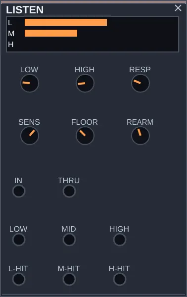

# LISTEN — o patch escuta

Desenvolvimento local, após 0.1.6. Na paleta, procure LISTEN em OUT e arraste
para o rack. O rack criado pela seed conserva sua formação anterior.
Ao adicioná-lo, ele entra na família OUT, antes de NOTE-OUT e SCOPE
no rack em ordem padrão. MIXER e MASTER continuam no final dessa família.
Você ainda pode arrastá-lo para outra posição.

LISTEN recebe áudio e devolve três forças e três ataques. Com uma bateria,
o grave pode conduzir as notas de uma voz enquanto os agudos abrem um filtro.
Um ataque pode aparecer em mais de uma saída: as bandas recortam frequências,
não reconhecem o nome do instrumento que você tocou.

IN recebe o som. THRU devolve esse som para o mixer se quiser ouvi-lo.
LOW, MID e HIGH são envelopes de controle; L-HIT, M-HIT e H-HIT disparam
eventos. Para escutar só a resposta do patch, deixe THRU sem conexão.

LOW e HIGH ajustam onde as regiões se encontram. RESP alonga a reação dos
níveis; SENS facilita ou dificulta a detecção de ataques. FLOOR impede que
ruído fraco dispare o patch. REARM aumenta o intervalo mínimo entre ataques
da mesma banda. Se faltam golpes, reduza REARM, baixe FLOOR ou aumente SENS.
Se dispara demais, tente o contrário, ouvindo o resultado a cada ajuste.
Depois de mover um corte, os ataques esperam 50 ms. Um corte modulado
continuamente pode mantê-los suspensos; os medidores de nível continuam ativos.

Os três medidores mostram níveis; o realce indica ataques recentes. No app,
ative LEARN e aponte para cada controle para sua explicação no idioma escolhido.

Experimento: abra [escuta_frase.rmp](../examples/escuta_frase.rmp) pelo botão
ABRIR do app recompilado. O DRUM toca, LISTEN detecta o grave e PHRASE
responde com notas. Desligue VARIA na primeira comparação para ouvir
o efeito de cada controle. Mude TONE e SNAP do DRUM e observe as bandas. Troque
L-HIT por H-HIT em CLK do PHRASE para mudar o que provoca a resposta.

Com áudio externo: SIGNAL-IN.OUT → LISTEN.IN, depois ligue o ON do
SIGNAL-IN por um gesto seu. Comece com o volume baixo e uma saída por vez.

Detalhes de filtros, tempo e limites: [dossiê](../dossies/61_listen.md).
