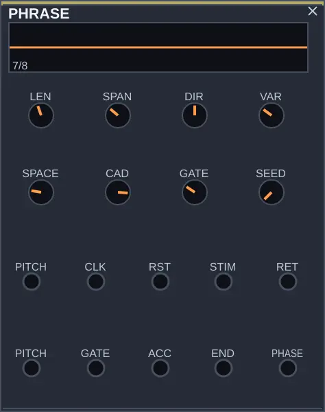

# PHRASE — voltar a uma ideia e tocá-la de outro jeito

Desenvolvimento local, após 0.1.6. PHRASE está em DECISION na paleta.
Ao adicioná-lo ao rack em ordem padrão, ele entra entre HARMONY e QUANTIZER.
Você ainda pode arrastá-lo para outra posição.
Ele precisa de pulsos em CLK: podem vir de CLOCK, LISTEN ou de outro gesto.

LEN escolhe quantos acontecimentos fazem uma frase. SEED escolhe um motivo;
SPAN abre seu âmbito. DIR puxa para baixo ou para cima; no centro mantém o
desenho do motivo. VAR transforma cada passagem sem perder o desenho de base.
Comece com VAR=0 para ouvir o que retorna; só depois abra a transformação.

SPACE deixa pausas no meio. CAD decide quanto o final volta ao apoio.
GATE regula a duração articulada. Ligue ACC a um VCA para ouvir o acento
de começo, meio e final; sem essa conexão, a voz pode tocar todas as notas
com a mesma força apesar de o PHRASE produzir acentos diferentes.

PITCH de entrada é o apoio da próxima frase, não uma ordem nova a cada
amostra. STIM recebe uma força, como LOW do LISTEN, para tornar a resposta
mais ou menos intensa. Um pulso em RET pede conclusão no próximo CLK.
RST recomeça. END pode chamar outra voz; PHASE pode conduzir uma abertura
de filtro ao longo do motivo.

Para uma escala: PHRASE.PITCH → QUANTIZER.CV; ajuste RANGE=1 no QUANTIZER.
QUANTIZER.PITCH → OSC.PITCH. PHRASE.GATE → ENVELOPE.GATE. OSC → ENVELOPE
→ VCA → MIXER → MASTER. PHRASE.ACC → VCA.CV1; nesse VCA, LVL1=0 e
CV1=1 permitem que o acento governe o nível.

O patch [escuta_frase.rmp](../examples/escuta_frase.rmp) já monta essa cadeia
com um DRUM e o LISTEN. Abra pelo botão ABRIR no app recompilado. Experimente
com VARIA desligada: primeiro DIR; depois VAR; depois SPACE e CAD.
Depois ligue VARIA para comparar. O que interessa ouvir é se a
voz passa a responder ao ataque, repetir uma ideia e abrir espaço entre falas.

Salva-se o motivo pela seed e pelos controles; reabrir começa uma nova
interpretação, não retoma a posição exata que estava tocando. A implementação
não incorpora um repertório cultural de frases nem captura suas melodias.

Contrato completo: [dossiê](../dossies/62_phrase.md).
